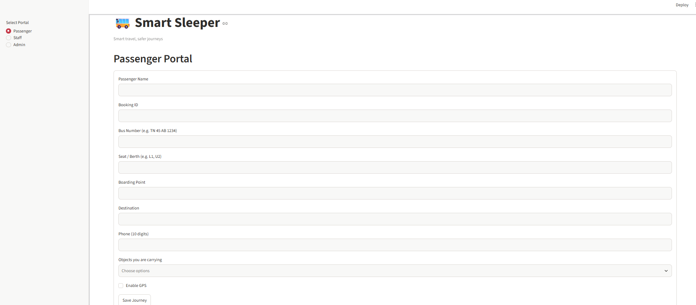

# Smart Sleeper 🚌😴

A Streamlit web app that helps bus passengers sleep safely during night journeys by alerting them before their destination arrives.

## Screenshots



## Features

- Three portals: Passenger, Staff and Admin
- Passenger journey registration (name, booking ID, bus number, seat/berth, boarding point)
- Alert system for journey updates
- Admin dashboard with journey records and alert status
- Download journey reports as CSV

## Tech Stack

- Python
- Streamlit
- Pandas
- Matplotlib

## How to Run

1. Clone the repo
   ```bash
   git clone https://github.com/SWATHIKA-11/smart-sleeper.git
   cd smart-sleeper
   ```

2. Create and activate a virtual environment
   ```bash
   python -m venv venv
   venv\Scripts\activate
   ```

3. Install dependencies
   ```bash
   python -m pip install -r requirements.txt
   ```

4. Run the app
   ```bash
   python -m streamlit run app.py
   ```

5. Open `http://localhost:8501` in your browser

## Admin Portal

The Admin Portal is password-protected (demo password only, not for production use).

## Author

Swathika
GitHub: [SWATHIKA-11](https://github.com/SWATHIKA-11)